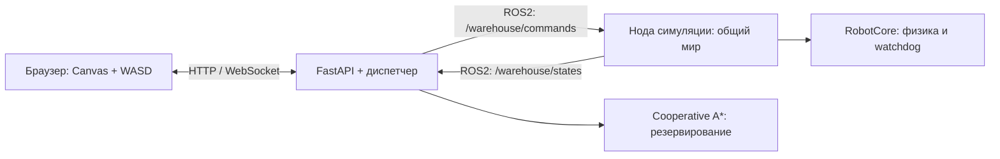

# Архитектура и выбор решений

## Компоненты

`warehouse/map.py` задаёт две карты. `warehouse/robot.py` содержит физику и общий мир, `warehouse/ros_simulator.py` подключает их к ROS2. `warehouse/dispatcher.py` принимает телеметрию, планирует и выдаёт команды. `warehouse/transport.py` изолирует rclpy; `warehouse/api.py` владеет диспетчером и предоставляет HTTP/WebSocket. Статический интерфейс находится в `warehouse/static/`.

Это два исполняемых процесса. Физическая нода владеет координатами всех роботов, потому что столкновения требуют единого мира и часов. У каждого робота отдельное состояние, идентификатор и приказы; наличие одной ноды мира не объединяет их маршруты в одного робота. Ядра не зависят от ROS, что позволяет быстро тестировать алгоритмы детерминированными часами. В рабочем запуске обмен идёт через настоящий DDS.

## Карта

Координаты заданы в метрах, ось X вправо, Y вверх. Шаг сетки — 2 м; склад 16×12 м. Нормальная карта содержит 31 узел, сложная — 20. Парковки называются `p1…p3` или `p1…p5` сверху вниз, остальные точки — `r<строка>c<столбец>`. Отсутствующие на схеме связи не добавляются. Четыре внешние стены имеют физические ограничения в ядре, а линии графа задают допустимые автоматические маршруты.

## Физическая модель

Робот — прямоугольный корпус 0.8×0.6 м, два ведущих колеса радиусом 0.1 м и колеёй 0.5 м. Кинематика дифференциальная: линейная скорость `v`, угловая `ω`, скорости колёс `(v ± ωb/2)/r`. Для постоянных скоростей используется точная интеграция дуги, а не зависящий от частоты кадров простой Euler.

При автоматическом переходе робот сначала разворачивается к следующему узлу, затем едет по ребру. Максимальная линейная скорость 0.8 м/с; угол ограничен 1.8 рад/с. В ручном режиме допускаются движение назад и одновременный поворот.

Для столкновений используется описанная вокруг корпуса окружность радиусом 0.5 м. Она консервативна и безопасна при любом развороте; точные OBB/SAT для этого масштаба добавили бы код без полезного выигрыша. Проверяется также пройденный за шаг отрезок и малая поправка на дугу, чтобы робот не перескочил через препятствие. Физический шаг — 20 мс, длинный кадр ограничивается 100 мс и делится на подшаги: симуляция может замедлиться под нагрузкой, но не переместит робота большим скачком.

## Планирование и уступание

Поиск ведётся в пространстве `(узел, дискретный раунд)`. Один переход — движение на соседний узел или ожидание. Время раунда не равно секунде: следующий раунд начинается только после подтверждения завершения всех переходов предыдущего. Поэтому скорость поворота, длина ребра и небольшой троттлинг не разрушают резервирование.

1. Собираем актуальные позиции и блокировки неисправных роботов.
2. Строим приоритетные пути A*, резервируя ресурсы ранее спланированных роботов. Эвристика — кратчайшее расстояние в невзвешенном графе, заранее найденное BFS.
3. При конфликте пробуем другой порядок приоритетов. Максимум пять роботов даёт не более 120 перестановок; также ограничены горизонт и общее число раскрытых состояний.
4. Проверенный совместный план хранится целиком. Выполняется один раунд, затем подтверждается `completed_command_id`. Перепланирование не сбрасывает заранее предусмотренное ожидание после каждого шага.
5. На весь переход заняты **оба конца ребра**. Запрещены встречный обмен, пересечение и следование в только что освобождающийся узел в том же раунде. Независимые переходы выполняются параллельно.

Нижестоящий по приоритету робот может отступить, подождать и вернуться. Если бездействующий робот занимает чужую цель, диспетчер выбирает ему временный свободный узел вне активного кратчайшего маршрута. Занятые пути заставляют поиск использовать другие доступные ветви.

Полный план не означает полный решатель: Cooperative A* может не найти существующее решение. В этом случае выдаётся причина ожидания, а поиск повторяется с ограниченной частотой. Это осознанный компромисс между простотой, временем разработки и безопасностью для маленького склада.

Если совместное планирование операторских заказов не удалось, пробуем выполнить один из них, временно уступая остальными роботами. До `R` дополнительных попыток делят тот же общий бюджет раскрытий `B`; исходные цели сохраняются. Для неудачного набора автоматически созданных целей «Тёмного цеха» вместо бесконечного повтора выбирается новый набор. Операторские цели автоматически не удаляются.

## Отказы и безопасность

Сам робот останавливает автоматическое движение через 0.9 с без продления, ручное — через 0.35 с. Диспетчер считает heartbeat устаревшим через 1.5 с. Повтор текущего `command_id` продлевает lease без перезапуска маршрута. Монотонные `command_seq` защищают от старых команд; `seq` и `boot_id` защищают телеметрию от повторов и перестановок. После нового мира старые сообщения фильтруются по `world_id`, а старые reset — по `reset_seq`.

При пропаже связи флот консервативно замирает, сохраняя неизвестно занятые ресурсы. Это снижает пропускную способность, но не предполагает, что пропавший робот успел остановиться в конкретной точке. После восстановления связи маршрут согласуется с фактическим состоянием. При подтверждённой неисправности робота его узлы и ребро удерживаются; независимые исправные переходы завершаются, и остальные перепланируются в обход блокировки. «Застрял» не означает автоматическое освобождение ресурсов по таймеру.

В ручном режиме весь флот на паузе. Возврат к автоматике требует привязки к узлу или сохранённому корректному ребру, а не свободного построения маршрута из произвольной координаты. Для небольшого отклонения до 0.2 м предусмотрена явная привязка при сбросе ошибки; это не скрытый телепорт через склад.

## Время и память

Пусть `V` — узлы, `E` — рёбра, `R≤5` — роботы, `H=3V+R²` — горизонт, `B=300000` — общий бюджет раскрытий.

| Операция | Время | Память |
|---|---|---|
| Подготовка расстояний BFS | `O(V(V+E))` | `O(V²)` |
| Один A* без учёта ограничений бюджета | `O((V+E)H log(VH))` | `O(VH)` |
| Поиск совместного плана с fallback, грубая верхняя оценка | `O((R+1) · R! · R · (V+E)H log(VH))`, раскрытия ограничены общим `B` | `O(V² + VH + RH)` при ограниченной степени графа |
| Физический шаг мира, включая привязку ручного робота | `O(R² + RV)` | `O(R)` |
| Подготовка телеметрии | `O(RV)` на цикл | `O(R)` для последних сообщений |
| Отрисовка | `O(V+E+R·L)` | `O(V+E+R·L)`, `L` — ограниченная длина следа |

Перестановки генерируются лениво, планы не хранятся для всех порядков одновременно. Неудачный поиск не запускается непрерывно каждый физический кадр. Журнал ограничен 100 событиями; дедупликация команд ограничена, очереди ROS имеют конечную глубину, телеметрия хранится как последнее сообщение на робота. История браузера также ограничена.

Исключение — множество ранее завершённых `boot_id`: оно хранится до смены мира, чтобы запоздалое сообщение старого запуска не принять за новый reboot. Память этой защиты `O(K)`, где `K` — количество перезапусков роботов в рамках одного мира; при обычной демонстрации `K=0`. Операция «Новая симуляция» сбрасывает это множество вместе с диспетчером. В промышленном протоколе эту историю разумно заменить устойчивой монотонной эпохой устройства.

Для сотен роботов понадобились бы другое планирование и пространственный индекс столкновений. Здесь такие решения усложнили бы защиту и разработку при отсутствии выигрыша на 2–5 роботах.
