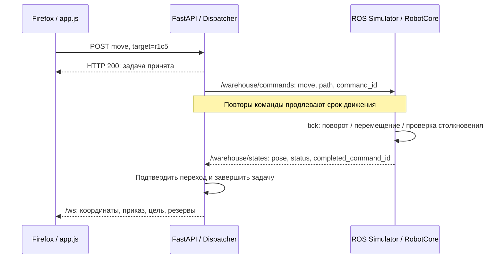

# Путь одной команды: показать руками и найти в коде

Это сценарий для Firefox, терминала и редактора кода. Рабочие исходники лежат
в `warehouse/`; учебные копии с построчными комментариями — в [commented/](commented/README.md).
Инструкция запуска — в [README](../README.md).

## Сначала три понятия

**Кинематика** описывает, как положение и угол меняются от заданных скоростей.
Например, при скорости 0,8 м/с за 0,5 с робот проходит 0,4 м по прямой.
В `RobotCore._integrate()` это формулы для `x`, `y`, `yaw` с учётом поворота.
Здесь скорости задаются сразу: массы, силы, разгон и проскальзывание не моделируются.
Столкновения со стенами и роботами проверяются отдельно.

**ROS-нода** — именованный участник системы ROS, который выполняет свою работу
и обменивается сообщениями. В этом проекте `/warehouse_simulator` рассчитывает мир,
а `/warehouse_dispatcher` отправляет приказы и принимает телеметрию.
Нода может жить внутри процесса вместе с другими нодами; у нас эти две ноды
запущены в разных процессах. См. [официальное объяснение ROS2](https://repo.test.ros2.org/en/jazzy/Tutorials/Beginner-CLI-Tools/Understanding-ROS2-Nodes/Understanding-ROS2-Nodes.html).

**Топик** — именованный канал сообщений: издатель публикует, подписчик получает.
Здесь `/warehouse/commands` передаёт приказы, `/warehouse/states` — состояния.
Класс `Node` в `map.py` означает навигационную точку, например `r1c5`.
Это другое понятие, чем ROS-нода. См. [ROS2: топики и `topic echo`](https://repo.test.ros2.org/en/jazzy/Tutorials/Beginner-CLI-Tools/Understanding-ROS2-Topics/Understanding-ROS2-Topics.html).

### Что значит «Подключено» на скриншоте

Зелёная надпись в правом верхнем углу относится к соединению **браузер ↔ сервер**
через WebSocket `/ws`. В `app.js:276` она появляется при открытии сокета,
в обработчике `message` внутри `connect()` — при получении очередного снимка.
Если после уже полученных данных новых сообщений нет больше 2,2 с,
проверка в `app.js:526` закрывает канал и запускается переподключение.

Связь **диспетчер ↔ робот** проверяется отдельно: в `Dispatcher.snapshot()`
робот считается в сети, пока возраст принятой телеметрии не превышает 1,5 с.
Это поля `robots[].connected` и `robots[].last_seen` в API и колонка «Связь».
Сервер может продолжать отправлять снимки со старыми позициями: верхняя надпись
останется зелёной, а конкретный робот получит состояние «Нет связи».
`link_state` различает `OFFLINE`, `RECOVERING` и `ONLINE`. Свежие сообщения
в RECOVERING дают `connected: true`, но движение ещё не разрешено.
`availability` отдельно отражает ошибку или паузу. Последняя/неподтверждённая
позиция выделяется в карточке, таблице и пунктирным полупрозрачным роботом на карте.

## 1. Подготовить простой опыт

1. Запустите `docker compose up --build -d` и откройте http://localhost:8000.
2. Выберите обычный склад, одного робота и нажмите «Новая симуляция».
3. Дождитесь робота `robot1` на парковке `p1`; «Тёмный цех» выключен,
   имитации отказов выключены, ручной режим выключен.
4. Выберите цель `r1c5`. Это сосед `p1`: получится один переход длиной 2 м.
5. Пока не нажимайте «Отправить»: сначала откройте инструменты и терминалы.



HTTP-запрос задаёт конечную цель. Для длинного маршрута диспетчер создаёт
несколько ROS-приказов, по одному ребру. У каждого перехода свой `command_id`.
Пример с соседним узлом позволяет проследить один такой приказ целиком.

## 2. Увидеть запрос в Firefox

Откройте F12 → **Сеть / Network** или нажмите Ctrl+Shift+E.
Перезагрузите страницу с открытыми инструментами, чтобы записалось подключение `/ws`.
Затем восстановите выбор `robot1` и цели `r1c5`, если он сбросился.
Порядок работы панели описан в [Firefox Network Monitor](https://firefox-source-docs.mozilla.org/devtools-user/network_monitor/index.html).

1. В фильтре URL введите `commands` и нажмите «Отправить» в приложении.
2. Выберите **POST** `/api/robots/robot1/commands`.
3. Во вкладке **Запрос / Request** найдите тело:

   ```json
   {"type":"move","target":"r1c5"}
   ```

4. Во вкладке **Ответ / Response** ожидается:

   ```json
   {"ok":true,"result":{"accepted":true,"robot_id":"robot1","type":"move","target":"r1c5"}}
   ```

5. Во вкладке времени можно посмотреть длительность HTTP-запроса.
   Она показывает время принятия задачи сервером. Поездка продолжается после ответа.

## 3. Увидеть, как возвращается состояние

Уберите текстовый фильтр `commands`, выберите фильтр **WS** и запрос `/ws`.
Ожидается переключение протокола с кодом **101**. Откройте вкладку
**Ответ / Response**: Firefox показывает сообщения WebSocket и раскрывает JSON.
См. [Firefox: просмотр WebSocket](https://firefox-source-docs.mozilla.org/devtools-user/network_monitor/inspecting_web_sockets/index.html).

В приходящих примерно пять раз в секунду снимках раскрывайте `robots[0]`.
Поля `dispatcher` и `metrics` находятся в корне снимка, рядом с `robots`:

| Поле | Что показать |
|---|---|
| `id` | `robot1` |
| `x`, `y`, `theta` | Положение и угол; при поездке координаты меняются |
| `v`, `omega` | Линейная и угловая скорости |
| `order.id` | `dispatch-...`: ID текущего приказа перехода |
| `node_id` | `p1` → обычно `null` между узлами → `r1c5` |
| `connected`, `last_seen` | Свежесть связи с роботом |
| `link_state`, `availability` | Связь ONLINE/OFFLINE/RECOVERING и состояния ERROR/PAUSED |
| `recovery_reason`, `recovery_ready` | Причина ожидания и готовность к явному resume |
| `position_stale` | Положение не подтверждено; координаты нельзя считать свежим фактом |
| `dispatcher.safety_stop` | Защитная остановка флота, отдельно от операторской паузы |
| `dispatcher.goals.robot1` | Конечная цель задачи, пока она не завершена |
| `metrics.completed_tasks` | Увеличится после достижения цели |

У `node_id` есть допуск близости к узлу, поэтому `null` появляется не мгновенно
после начала движения. По завершении цель удаляется из `goals`, скорости равны
нулю, а `order` становится `null`. Для повторного опыта создайте новую симуляцию.

`completed_command_id` есть в исходной ROS-телеметрии; браузерный снимок его
напрямую не содержит. В следующем разделе посмотрим его на стороне ROS.

### Дополнительно: короткая таблица в консоли Firefox

Этот фрагмент открывает ещё одно соединение `/ws` только для наблюдения.
Вставляйте его в консоль страницы приложения до отправки команды.
Глобальная переменная `state` приложения скрыта внутри функции; фрагмент
использует собственный сокет и не зависит от доступа к ней.

```js
(() => {
  window.commandDemo?.close();
  const protocol = location.protocol === "https:" ? "wss:" : "ws:";
  const socket = new WebSocket(`${protocol}//${location.host}/ws`);
  window.commandDemo = socket;
  let previous = "";
  socket.addEventListener("message", ({ data }) => {
    const snapshot = JSON.parse(data);
    const robot = snapshot.robots.find((item) => item.id === "robot1");
    if (!robot) return;
    const row = {
      world: snapshot.world_id.slice(0, 8),
      goal: snapshot.dispatcher.goals.robot1 ?? "—",
      command_id: robot.order?.id ?? "—",
      node: robot.node_id ?? "между узлами",
      x: Number(robot.x.toFixed(2)),
      y: Number(robot.y.toFixed(2)),
      speed: robot.v,
      state: robot.state,
      connected: robot.connected,
      completed: snapshot.metrics.completed_tasks,
    };
    const signature = JSON.stringify(row);
    if (signature !== previous) console.table([row]);
    previous = signature;
  });
  console.info("Наблюдение включено. Остановить: window.commandDemo.close()");
})();
```

После опыта выполните `window.commandDemo.close()`, чтобы прекратить вывод.
Перезагрузка страницы тоже закрывает наблюдение.

## 4. Остановиться на строках JavaScript

В F12 откройте **Отладчик / Debugger**, найдите `static/app.js`.
Можно искать имя файла через Ctrl+P; сверяйте номера с оригиналом из `warehouse/static/`.

Поставьте точку останова на `app.js:96`, на вызове `fetch` внутри `request()`.
Снова отправьте команду. До отправки HTTP-запроса выполнение остановится.
В области переменных или консоли текущего кадра покажите:

```text
path     = /api/robots/robot1/commands
payload  = { type: "move", target: "r1c5" }
```

В стеке вызовов будут `request`, `command`, `operatorCommand` и обработчик клика.
`request()` вызывается из `command()` на строке 107, а кнопка подключена на строке 432.
Именно этот стек объясняет, как нажатие стало сетевым запросом.
У Firefox также есть [точки останова по URL запроса](https://firefox-source-docs.mozilla.org/devtools-user/debugger/set_an_xhr_breakpoint/index.html);
обычная точка на строке `fetch` подходит непосредственно для нашего кода.

Для обратного пути поставьте точку на `app.js:209`, внутри `acceptSnapshot()`.
Условие точки останова можно задать так:

```js
snapshot.robots.some((robot) => robot.id === "robot1" && robot.order?.id)
```

После продолжения выполнения покажите аргумент `snapshot`: это то же состояние,
которое видно в сетевой вкладке. `acceptSnapshot()` обновляет данные интерфейса,
а `draw()` и `drawRobot()` затем рисуют робота на canvas.

Firefox останавливает JavaScript страницы. Python и симулятор продолжают работу
в контейнере, поэтому робот может успеть доехать, пока вы рассматриваете переменные.
Перед новым опытом снимите точки останова и создайте свежую сцену.
Длительная пауза также может вызвать переподключение UI после продолжения JavaScript.

## 5. Увидеть приказы и подтверждения в ROS2

Откройте **два терминала** в папке проекта до нажатия «Отправить».
Эти команды подходят для PowerShell и терминала Ubuntu.

Терминал 1 — приказы:

```sh
docker compose exec warehouse bash -lc "source /workspace/install/setup.bash && ros2 topic echo /warehouse/commands std_msgs/msg/String --field data --full-length"
```

Терминал 2 — состояния:

```sh
docker compose exec warehouse bash -lc "source /workspace/install/setup.bash && ros2 topic echo /warehouse/states std_msgs/msg/String --qos-reliability best_effort --field data --full-length"
```

`exec` выполняет команду в работающем контейнере; `source .../setup.bash`
подключает окружение ROS-пакета; `topic echo` печатает сообщения;
`--field data` выбирает JSON-строку из сообщения `String`;
`--full-length` запрещает обрезать длинную строку. Ctrl+C прекращает наблюдение.

Нажмите «Отправить». В первом терминале найдите сообщение:

```json
{"robot_id":"robot1","command_id":"dispatch-N","type":"move","path":["p1","r1c5"],"world_id":"...","command_seq":1}
```

Это схема реального сообщения: номер `N`, `command_seq` и `world_id` будут своими.
Одинаковые `command_id` повторяются, пока робот выполняет переход: так продлевается
lease — срок разрешения движения. Повтор не запускает маршрут с начала.

Во втором терминале в сообщениях `robot1` покажите:

```text
current_order.command_id = тот же dispatch-N во время движения
pose.x, pose.y           = меняются при поездке
completed_command_id     = тот же dispatch-N после прибытия
node_id                  = r1c5
status                   = idle
```

Это прямое подтверждение, что приказ прошёл через ROS до модели робота.
`command_seq` защищает порядок приказов; `seq` в состояниях — другой счётчик,
он защищает порядок телеметрии. `world_id` связывает сообщения с одной сценой.

В контрольном прогоне 27 октября 2026 года цепочка проверена через работающие
HTTP, WebSocket и DDS: запрос принят, `order.id` и ROS `command_id` равны
`dispatch-2`, затем получен `completed_command_id: dispatch-2` и `node_id: r1c5`
с координатами `(12, 8)`. До фиксации прибытия получено 14 WebSocket-снимков.
Конкретные ID и число снимков при повторе могут отличаться.
Шаги интерфейса Firefox сверены с документацией Mozilla; сам Firefox
автоматически в этом прогоне не управлялся.

Посмотреть участников и их связи:

```sh
docker compose exec warehouse bash -lc "source /workspace/install/setup.bash && ros2 node list"
docker compose exec warehouse bash -lc "source /workspace/install/setup.bash && ros2 node info /warehouse_simulator"
```

Наблюдатели `topic echo` сами создают ROS-ноды: дополнительные имена
`/_ros2cli_...` во время опыта нормальны.

## 6. Где показывать этот путь в редакторе

Открывайте оригиналы; Ctrl+G позволяет перейти к номеру строки JavaScript.
В учебных копиях ищите метку `Lномер`: она ссылается на строку оригинала.
Серверные участки ищите по именам функций: добавление метрик и событий меняет номера строк.

| Шаг | Файл / функция | Что показать |
|---|---|---|
| Нажатие | [app.js](../warehouse/static/app.js), строка 432 | Обработчик «Отправить» собирает `move` и цель |
| HTTP | `app.js`, 108 → 107 → 92–96 | `operatorCommand` → `command` → `request` → `fetch` |
| Проверка запроса | [api.py](../warehouse/api.py), `Command`, обработчик `command()` | Проверка полей и передача задачи диспетчеру |
| Назначение цели | [dispatcher.py](../warehouse/dispatcher.py), `Dispatcher.submit()` | Запись `goals`, это ещё не движение |
| Цикл управления | `api.py`, `FleetRuntime.run()` / `step()` | Приём состояний, вызов `tick()`, отправка приказов |
| Планирование | `dispatcher.py`, `tick()` → `_build_schedule()` → `_plan_schedule()` → `plan()` → `_search()` | Согласование безопасного расписания и измерение времени |
| Один переход | `dispatcher.py`, `_round`, `_command()` | Разрешение одного ребра с ID приказа |
| ROS-публикация | `FleetRuntime.send()`; [transport.py](../warehouse/transport.py), `RosTransport.send()` | `world_id`, `command_seq`, `publish()` |
| Приём симулятором | [ros_simulator.py](../warehouse/ros_simulator.py), `SimulatorNode._command()` | Разбор JSON |
| Проверка мира и приказа | [robot.py](../warehouse/robot.py), `WorldCore.command()` → `RobotCore.command()` | Сцена, ревизия, дедупликация и разрешённое ребро |
| Движение | `robot.py`, `RobotCore.tick()` → `_integrate()` → `_collision()` | Движение и геометрическая проверка до изменения позиции |
| Подтверждение | `RobotCore.tick()` / `telemetry()` | Запись `completed_command_id`, подготовка состояния |
| Обратный ROS-путь | `SimulatorNode._tick()`; `RosTransport._receive()` | Публикация, сохранение последнего состояния |
| Обработка результата | `FleetRuntime.step()`; `Dispatcher.ingest()` / `tick()` | Приём состояния, подтверждение перехода |
| Восстановление | `Dispatcher._mark_offline()` / `_recovery_problem()` / `_confirm_recovery()` | Сохранение ресурсов и проверка возвращённой телеметрии |
| Наблюдаемость | `Dispatcher.drain_events()`; `FleetRuntime.drain_dispatcher_events()` / `health()` / `metrics_snapshot()` | UTC-события, показатели и готовность сервиса |
| Обновление браузера | `api.py`, обработчик `websocket()`; `app.js`, `connect()` (272), `acceptSnapshot()` (208) | `/ws` → `message` → обновление состояния UI |
| Отрисовка | `app.js`, `draw()` (321), `drawRobot()` (382) | Подтверждённое или явно неподтверждённое положение |

В `FleetRuntime.snapshot_json()` несколько WebSocket-клиентов
получают одну сериализованную версию, пока она не устарела или не инвалидирована.
Свежий снимок для REST собирается отдельно; кэш не участвует в управлении движением.

На границе HTTP/ROS стек вызовов браузера заканчивается. Firefox не умеет
продолжить его в Python. Поэтому в демонстрации сопоставляем тело запроса,
сцену `world_id`, приказ `command_id` и последующие состояния, а функции Python
показываем в редакторе. API не возвращает общий `trace_id` всей цепочки.

## 7. Показать разницу двух соединений

Снимите точки останова. На сцене с одним роботом включите в UI «Потеря связи».
Спустя более 1,5 с в снимке будет `robots[0].connected: false`, а вверху страницы
может оставаться «Подключено»: WebSocket с сервером продолжает работать.
Выключите отказ и дождитесь свежих состояний.
После возврата сообщений робот сначала RECOVERING: `connected: true` ещё
не означает безопасного продолжения. Для обычного случая подтверждённая остановка
и корректное положение позволяют вернуться в ONLINE. При reboot остаётся явная
пауза до команды оператора, даже когда `recovery_ready: true`.

Если вместо этого остановить контейнер, браузер потеряет сам WebSocket
и начнёт переподключаться. Для демонстрации отказа робота контейнер останавливать
не требуется.

Замедление сети в Firefox относится к участку браузер ↔ HTTP/WebSocket.
Для проверки плохой связи робота с диспетчером используйте имитацию отказов UI:
она действует внутри `WorldCore` на команды и телеметрию ROS.

## 8. Короткая демонстрация отказоустойчивости для работодателя

1. Создайте обычный склад с двумя роботами, выключенными отказами и «Тёмным цехом».
   Откройте F12 → Сеть → `/ws`, `/api/health`, `/metrics` и терминал
   `docker compose logs -f warehouse`.
2. Отправьте `robot1` к дальней точке. Посреди ребра включите «Потеря связи».
   После тайм-аута покажите OFFLINE, `position_stale`, последнюю позицию,
   `dispatcher.safety_stop` и сохранённые `reservations`. Второй робот ждёт.
3. Покажите `warehouse_link_loss_events_total` и `warehouse_fleet_safety_stops_total`:
   повторные тики не должны добавлять новые события того же эпизода.
   Health после начальной синхронизации остаётся HTTP 200, пока второй робот
   продолжает передавать свежую телеметрию; `fleet.offline` и `safety_stop` отражают отказ.
4. Чтобы RECOVERING был заметен дольше одного тика, включите «Застревание»
   ещё при отключённой связи, затем выключите «Потеря связи».
   Сообщения вернутся, но ошибка удержит RECOVERING и защитную остановку.
   Без ошибки правильный возврат может пройти RECOVERING быстрее очередного 5-Гц кадра UI.
5. Снимите «Застревание», затем сбросьте ошибку. Покажите подтверждённое
   `ERROR_CLEARED`, проверку положения и продолжение той же цели без новой миссии.
   `LINK_RECOVERED` означает возврат канала, `FLEET_RESUMED` — возобновление движения.
6. Reboot посреди перехода покажите воспроизводимым регрессионным тестом:

   ```sh
   docker run --rm dikom-tests python -m pytest tests/test_recovery.py -k reboot -v
   ```

   Откройте `test_reboot_in_transition_preserves_mission_and_requires_explicit_resume`:
   новый `boot_id`, сохранённые ресурсы, RECOVERING и `recovery_ready` не запускают
   движение до `resume`. Этот тест меняет запуск робота без подмены сценой reset.

Не перезапускайте весь контейнер вместо опыта reboot одного робота: контейнерный
рестарт создаёт новую сцену и проверяет другой сценарий.

## Короткий рассказ при показе

«Я нажимаю кнопку и вижу JSON-запрос с целью. Сервер принимает задачу.
Диспетчер проверяет занятость и разрешает один переход. В терминале виден
ROS-приказ с ID. Симулятор меняет координаты и сообщает завершение с тем же ID.
Диспетчер подтверждает переход, а WebSocket доставляет новое положение браузеру».
